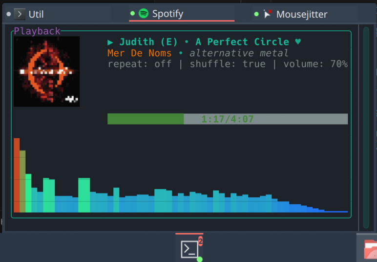

# Termibar



KDE Plasma 6 plasmoid that pins TUI applications to your panel. Close the popup, the process keeps running. Reopen it, you're right where you left off.

## Features

- Multiple terminal tabs in a single widget
- Per-tab commands and working directory — run spotify_player, htop, or any TUI
- Processes survive popup close/open cycles
- Per-tab autostart with panel
- Native KDE icon picker in settings
- Live config updates without restart

## Dependencies

### Runtime

- KDE Plasma 6 (>= 6.0)
- Qt 6 (>= 6.8)
- Konsole KPart (`konsole-kpart` on Debian, `konsole-part` on Fedora, `konsole` on Arch)

### Build

```bash
# Debian/Ubuntu/KDE Neon
sudo apt install cmake qt6-base-dev qt6-declarative-dev extra-cmake-modules libkf6parts-dev

# Arch
sudo pacman -S cmake qt6-base qt6-declarative extra-cmake-modules kparts

# Fedora
sudo dnf install gcc-c++ cmake qt6-qtbase-devel qt6-qtdeclarative-devel extra-cmake-modules kf6-kparts-devel
```

## Install

```bash
git clone https://github.com/ekats/termibar.git
cd termibar
./install.sh
```

The install script builds the C++ plugin, installs it to the system Qt QML path (requires sudo), installs the plasmoid, and restarts plasmashell.

After install, right-click your panel → Add Widgets → search "Termibar".

## Update

```bash
./install.sh
```

Same script handles updates.

## Known Limitations

- Terminal cursor renders hollow (Wayland focus model mismatch — typing works fine)
- Konsole KPart inherits Konsole's profiles and color schemes — font and colors are configured in Konsole, not here
- Autostart opens the popup once at login: the KPart can only embed into an existing popup window
- The popup opens at the size set in settings, so dragging its edge works but is not remembered (Plasma's saved popup size is overridden on every open)
- With the popup open and a session running, plasmashell ignores a graceful quit (SIGTERM, `killall plasmashell`, logout) — the embedded terminal widget blocks it. Close the popup first, or use `killall -9 plasmashell`

## License

AGPL-3.0
